<div align="center">



<p>
  
  
  
  
</p>



</div>

### 

```yaml
player: Arianit Sheholli
class: Cloud Solution Architect @ Microsoft
home_stage: Duisburg, Germany 🇩🇪
currently_training:
  - 🧠 Designing LLM & GenAI solutions on Azure
  - 🛡️ LLM guardrails, evaluation & MLOps pipelines
  - 🔎 RAG, agents & Model Context Protocol (MCP)
  - 🤖 GitHub Copilot developer experiences
interests: [LLMs, Machine Learning, MLOps, AI Agents, Cloud Architecture]
win_quote: "I teach AI to write code, then review what it wrote 😄"
```

### 

<p align="center">
  
</p>

| Special move | Command | Effect |
|:--|:--:|:--|
| 🛡️ **Guardrail Counter** | `← + K` | Blocks hallucinations & prompt injections before they reach prod |
| 🔎 **RAG Uppercut** | `↓ ↘ → + P` | Launches answers grounded in your own data |
| 🤖 **Agent Combo** | `P, P, K` | Plans, calls tools over MCP, ships the result |
| 🧪 **MLOps Chain** | `→ → + P + K` | Train → evaluate → deploy → monitor, on repeat |
| ☁️ **Cloud Launcher** | `↓ ↓ ↑ + K` | Azure infrastructure as code with Terraform & GitHub Actions |
| 🤝 **Copilot Assist** | `P + K` | Pair programming with GitHub Copilot at 2× speed |

<p align="center">
  
  
  
  
  
  
  
  
</p>

### 

<table>
<tr>
<td width="50%" valign="top">

#### 🛡️ STAGE 1 · [llm-guardrail-mlops](https://github.com/Ar1anit/llm-guardrail-mlops)
MLOps workflow for building and shipping guardrails for LLMs.


</td>
<td width="50%" valign="top">

#### ⛈️ STAGE 2 · [lab-ghcp-mcp-stormwatch](https://github.com/Ar1anit/lab-ghcp-mcp-stormwatch)
Hands-on lab: GitHub Copilot × Model Context Protocol.


</td>
</tr>
<tr>
<td width="50%" valign="top">

#### 🌍 STAGE 3 · [tf-gha-beginners](https://github.com/Ar1anit/tf-gha-beginners)
Beginner-friendly Terraform deployments with GitHub Actions.


</td>
<td width="50%" valign="top">

#### 🧩 STAGE 4 · [ghcp-platfrom-repo](https://github.com/Ar1anit/ghcp-platfrom-repo)
Platform setup and patterns for GitHub Copilot.


</td>
</tr>
</table>

### 

<div align="center">
  
</div>

### 

<div align="center">
  
</div>

### 

<p align="center">
  <a href="https://github.com/Ar1anit"></a>
  <a href="https://www.linkedin.com/"></a>
</p>

<div align="center">

</div>
